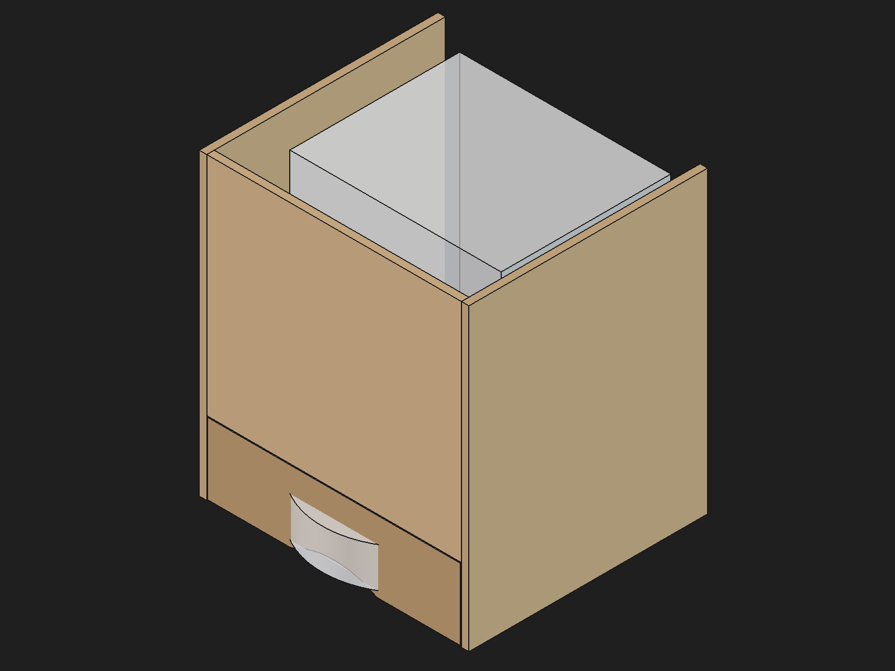
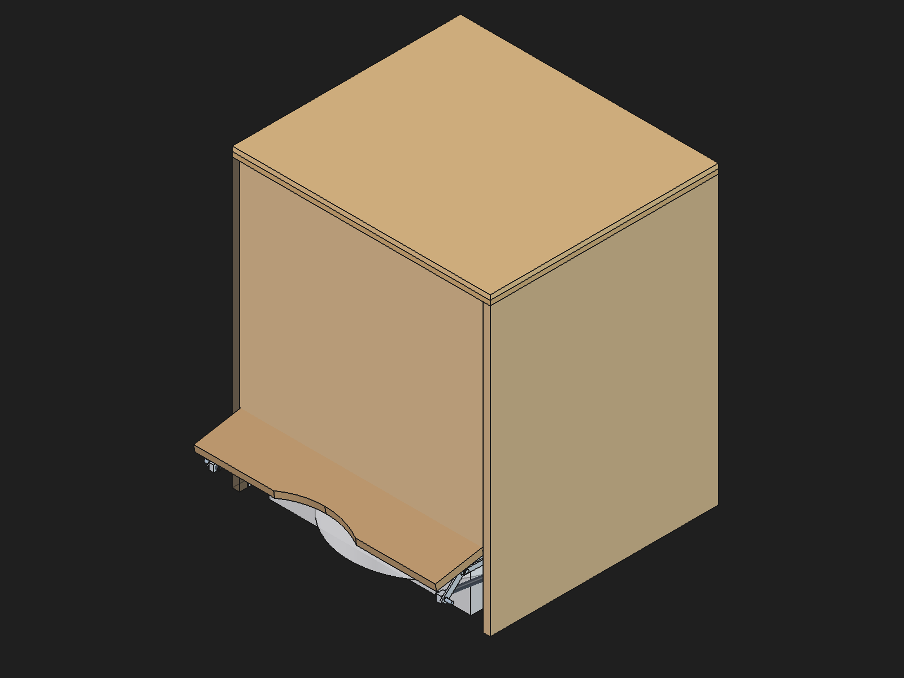
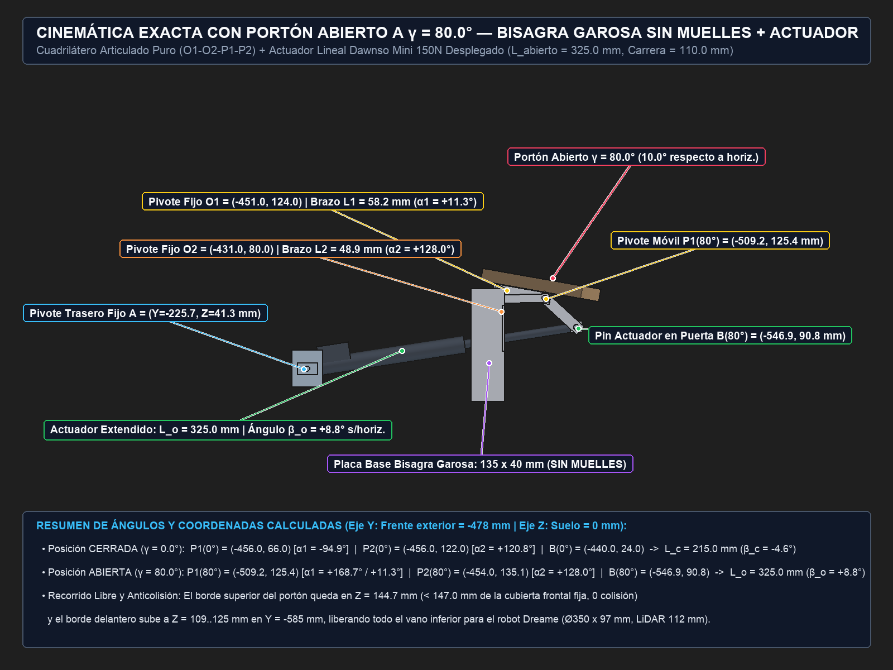
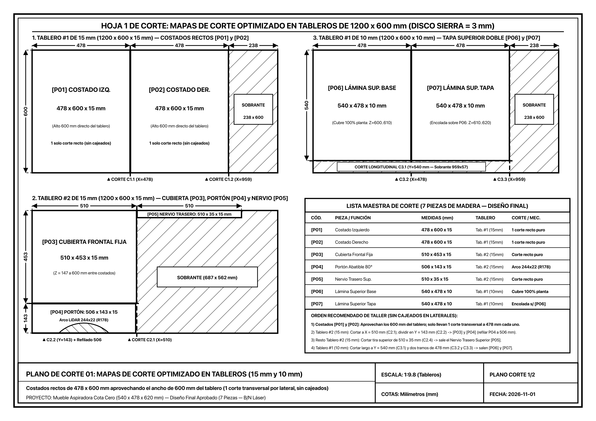
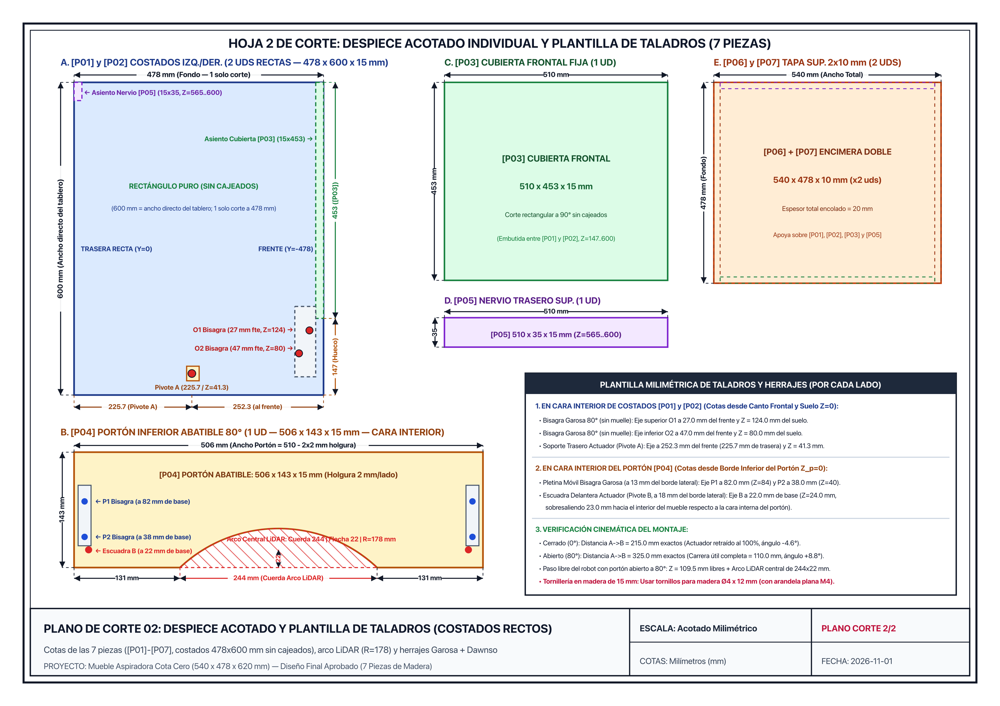

# Mueble Automatizado a Cota Cero para Robot Aspirador Dreame (Diseño Final: $540 \times 478 \times 620\text{ mm}$)

Módulo cubre-base a medida diseñado para ocultar la estación de autovaciado y robot aspirador **Dreame (L10s / X40)** a **Cota Cero**, con **portón inferior abatible frontal de $80^\circ$** mediante **bisagras articuladas Garosa $135 \times 40 \times 35\text{ mm}$ (sin muelles)** accionado por **2 actuadores lineales Dawnso Mini 150N ($215/325\text{ mm}$, carrera $110\text{ mm}$)** y control nativo por **Zigbee (Home Assistant)**.

| Vista 3D Cerrado ($540 \times 478 \times 620\text{ mm}$) | Vista 3D Portón Abierto a $80^\circ$ | Cinemática Lateral Exacta ($80^\circ$) |
| :---: | :---: | :---: |
|  |  |  |

---

## 1. Modelos 3D CAD en FreeCAD y Planos Técnicos ISO A4

### 1.1. Modelos 3D Maestros (`.FCStd` y `.step`)
* [`Mueble_Aspiradora_Cota_Cero.FCStd`](Mueble_Aspiradora_Cota_Cero.FCStd): Modelo CAD 3D maestro en estado cerrado ($\theta = 0^\circ$) con las 6 hojas técnicas ISO A4 integradas en TechDraw.
* [`Modulo_01_Porton_Abierto_80deg.FCStd`](Modulo_01_Porton_Abierto_80deg.FCStd): Modelo CAD 3D con el portón abierto a $\theta = 80^\circ$ y los actuadores extendidos a $325,0\text{ mm}$ ($\beta_o = +8,8^\circ$).
* [`Mecanismo_Metalico_Bisagras_y_Actuadores.FCStd`](Mecanismo_Metalico_Bisagras_y_Actuadores.FCStd) y [`planos/Mecanismo_Metalico_Bisagras_y_Actuadores.step`](planos/Mecanismo_Metalico_Bisagras_y_Actuadores.step): Modelo 3D aislado exclusivamente con los herrajes metálicos (bisagras Garosa sin muelles + escuadras) y los 2 actuadores lineales.

### 1.2. Dossiers de Planos ISO A4 Listos para Impresión
* **Dossier de Corte y Mecanizado de Madera (2 Hojas A4)**: [`planos/Planos_Corte_Madera_Diseño_Final_A4.pdf`](planos/Planos_Corte_Madera_Diseño_Final_A4.pdf)
* **Dossier Maestro Completo del Proyecto (6 Hojas A4)**: [`planos/Planos_Mueble_Aspiradora_Completo_A4.pdf`](planos/Planos_Mueble_Aspiradora_Completo_A4.pdf)

| Hoja | Vista Previa / Archivos | Contenido |
| :--- | :--- | :--- |
| **Corte 1/2** | [`Plano_Corte_01_Mapas_Tableros_A4.pdf`](planos/Plano_Corte_01_Mapas_Tableros_A4.pdf) · [`.png`](planos/Plano_Corte_01_Mapas_Tableros_A4.png) | Mapas de corte a escala sobre **2 tableros de $1200 \times 600 \times 15\text{ mm}$** y **1 tablero de $1200 \times 600 \times 10\text{ mm}$** + secuencia de 8 cortes rectos. |
| **Corte 2/2** | [`Plano_Corte_02_Despiece_Acotado_Piezas_A4.pdf`](planos/Plano_Corte_02_Despiece_Acotado_Piezas_A4.pdf) · [`.png`](planos/Plano_Corte_02_Despiece_Acotado_Piezas_A4.png) | Despiece acotado individual de las **7 piezas (`[P01]`–`[P07]`)**, arco LiDAR ($244 \times 22\text{ mm}, R=178\text{ mm}$) y **plantilla milimétrica de taladros**. |
| **Plano 01** | [`Plano_01_Alzado_y_Planta_A4.pdf`](planos/Plano_01_Alzado_y_Planta_A4.pdf) · [`.svg`](planos/Plano_01_Alzado_y_Planta_A4.svg) | Alzado frontal y planta superior acotados. |
| **Plano 02** | [`Plano_02_Perfil_e_Isometrica_A4.pdf`](planos/Plano_02_Perfil_e_Isometrica_A4.pdf) · [`.svg`](planos/Plano_02_Perfil_e_Isometrica_A4.svg) | Sección lateral y vista isométrica general. |
| **Plano 03** | [`Plano_03_Despiece_Carpinteria_A4.pdf`](planos/Plano_03_Despiece_Carpinteria_A4.pdf) · [`.svg`](planos/Plano_03_Despiece_Carpinteria_A4.svg) | Vistas de carpintería y lista de materiales (BOM). |
| **Plano 04** | [`Plano_04_Cinematica_Bisagras_80deg_y_Actuadores_A4.pdf`](planos/Plano_04_Cinematica_Bisagras_80deg_y_Actuadores_A4.pdf) · [`.svg`](planos/Plano_04_Cinematica_Bisagras_80deg_y_Actuadores_A4.svg) | Cinemática de las bisagras Garosa $80^\circ$ sin muelles y actuadores Dawnso Mini 150N. |

| Hoja 1 de Corte: Mapas de Tableros | Hoja 2 de Corte: Despiece Acotado y Taladros |
| :---: | :---: |
|  |  |

---

## 2. Dimensiones Generales y Despiece de Madera (7 Piezas)

* **Dimensiones Exteriores Totales**: **$540\text{ mm}$ (Ancho) $\times 478\text{ mm}$ (Fondo exacto desde pared) $\times 620\text{ mm}$ (Alto: $600\text{ mm}$ costados $+ 20\text{ mm}$ tapa superior doble)**.
* **Hueco Interior Libre**: **$510\text{ mm}$ (Ancho) $\times 463\text{ mm}$ (Fondo útil tras frente de $15\text{ mm}$) $\times 600\text{ mm}$ (Alto bajo tapa)**.

| Cód. | Pieza | Dimensiones ($\text{mm}$) | Tablero ($1200 \times 600$) | Corte y Mecanizado |
| :--- | :--- | :---: | :--- | :--- |
| **`[P01]`** | Costado Izquierdo | **$478 \times 600 \times 15$** | Tablero #1 ($15\text{ mm}$) | **1 corte transversal recto** a $478\text{ mm}$ ($600\text{ mm}$ directo del ancho del tablero, sin cajeados) |
| **`[P02]`** | Costado Derecho | **$478 \times 600 \times 15$** | Tablero #1 ($15\text{ mm}$) | **1 corte transversal recto** a $478\text{ mm}$ ($600\text{ mm}$ directo del ancho del tablero, sin cajeados) |
| **`[P03]`** | Cubierta Frontal Fija | **$510 \times 453 \times 15$** | Tablero #2 ($15\text{ mm}$) | Corte recto puro ($Z \in [147, 600]\text{ mm}$, embutida entre costados) |
| **`[P04]`** | Portón Abatible $80^\circ$ | **$506 \times 143 \times 15$** | Tablero #2 ($15\text{ mm}$) | $Z \in [2, 145]\text{ mm}$ ($2\text{ mm}$/lado holgura) + arco central LiDAR ($244 \times 22\text{ mm}, R=178\text{ mm}$) |
| **`[P05]`** | Nervio Trasero Superior | **$510 \times 35 \times 15$** | Tablero #2 ($15\text{ mm}$) | Corte recto puro ($Z \in [565, 600]\text{ mm}, Y \in [-15, 0]\text{ mm}$, pegado bajo la tapa superior) |
| **`[P06]`** | Lámina Superior Base | **$540 \times 478 \times 10$** | Tablero #1 ($10\text{ mm}$) | Corte recto puro; cubre el $100\%$ de la superficie superior ($Z \in [600, 610]\text{ mm}$) |
| **`[P07]`** | Lámina Superior Tapa | **$540 \times 478 \times 10$** | Tablero #1 ($10\text{ mm}$) | Corte recto puro; encolada sobre `[P06]` formando tapa rígida de $20\text{ mm}$ ($Z \in [610, 620]\text{ mm}$) |

---

## 3. Distancias Exactas de los Agujeros de Montaje (Madera, Bisagras Garosa $80^\circ$ y Actuadores Dawnso)

### 3.1. Unión entre Piezas de Madera (`[P01]`–`[P07]`)

| Pieza | Código Taladro | Posición Exacta ($\text{mm}$) | Separación / Paso | Función y Tornillería |
| :--- | :--- | :--- | :---: | :--- |
| **`[P01]` / `[P02]`** (Costados $478 \times 600 \times 15$) | **`M_F1`..`M_F4`** (4 uds/lado) | A **$7,5\text{ mm}$ del frente** ($Y = -470,5\text{ mm}$), en **$Z = 180, 310, 440, 570\text{ mm}$** | **$130,0\text{ mm}$** | Unión con cantos laterales de `[P03]` (taladros guía $\varnothing 3\text{ mm}$ a $33, 163, 293, 423\text{ mm}$ de la base de `[P03]`; tornillos $\varnothing 4 \times 40\text{ mm}$). |
| **`[P01]` / `[P02]`** (Costados $478 \times 600 \times 15$) | **`M_N1`** (1 ud/lado) | A **$7,5\text{ mm}$ de la trasera** ($470,5\text{ mm}$ del frente), en **$Z = 582,5\text{ mm}$** ($17,5\text{ mm}$ del borde sup.) | Centro de $35\text{ mm}$ | Unión con las testas del nervio trasero `[P05]` (tornillos $\varnothing 4 \times 40\text{ mm}$). |
| **`[P06]`** (Lámina Base $540 \times 478 \times 10$) | **`M_T1`..`M_T6`** (3 uds/lado) | A **$7,5\text{ mm}$ de los bordes laterales** ($X = 7,5$ y $532,5\text{ mm}$), en **$Y_{frente} = 60, 239, 418\text{ mm}$** | **$179,0\text{ mm}$** | Fijación superior hacia costados `[P01]` y `[P02]` (tornillos $\varnothing 4 \times 30\text{ mm}$ avellanados, ocultos bajo `[P07]`). |
| **`[P06]`** (Lámina Base $540 \times 478 \times 10$) | **`M_T7`..`M_T10`** (2 fr. + 2 tras.) | A **$7,5\text{ mm}$ del frente** y **$7,5\text{ mm}$ de la trasera**, en **$X = 170,0$ y $370,0\text{ mm}$** | **$200,0\text{ mm}$** | Fijación hacia `[P03]` y `[P05]` (a $155$ y $355\text{ mm}$ del extremo izq. de `[P03]`/`[P05]`; tornillos $\varnothing 4 \times 30\text{ mm}$). |

### 3.2. Bisagras Garosa $135 \times 40 \times 35\text{ mm}$ ($80^\circ$ Sin Muelles, SKU `B0BX5QCP6J`) — Tornillos $\varnothing 4 \times 12\text{ mm}$

| Elemento de Bisagra | Código Agujero | Distancia al Borde ($\text{mm}$) | Altura $Z$ ($\text{mm}$) | Separación Entre Agujeros |
| :--- | :--- | :---: | :---: | :--- |
| **`Placa_Costado`** ($100 \times 36\text{ mm}$ en `[P01]`/`[P02]`, base en $Z_0 = 2,0\text{ mm}$) | **`H_C1`** (Sup., $\varnothing 6,0\text{ mm}$) | **$41,0\text{ mm}$ del canto frontal** ($26\text{ mm}$ tras portón) | **$Z = 98,0\text{ mm}$** ($v = 96,0\text{ mm}$) | Referencia superior |
| **`Placa_Costado`** ($100 \times 36\text{ mm}$) | **`H_C2`** (Med-Alto, $\varnothing 4,5\text{ mm}$) | **$38,0\text{ mm}$ del canto frontal** ($23\text{ mm}$ tras portón) | **$Z = 66,0\text{ mm}$** ($v = 64,0\text{ mm}$) | **$32,0\text{ mm}$** respecto a `H_C1` |
| **`Placa_Costado`** ($100 \times 36\text{ mm}$) | **`H_C3`** (Med-Bajo, $\varnothing 6,0\text{ mm}$) | **$35,0\text{ mm}$ del canto frontal** ($20\text{ mm}$ tras portón) | **$Z = 34,0\text{ mm}$** ($v = 32,0\text{ mm}$) | **$32,0\text{ mm}$** respecto a `H_C2` |
| **`Placa_Costado`** ($100 \times 36\text{ mm}$) | **`H_C4`** (Inf., $\varnothing 4,5\text{ mm}$) | **$25,0\text{ mm}$ del canto frontal** ($10\text{ mm}$ tras portón) | **$Z = 6,5\text{ mm}$** ($v = 4,5\text{ mm}$) | **$27,5\text{ mm}$** respecto a `H_C3` |
| **`Escuadra_Puerta`** ($62,5 \times 14\text{ mm}$ en cara int. de `[P04]`) | **`T_P1`** (Ranura keyhole sup.) | **$8,0\text{ mm}$ del borde lateral** ($X_{loc} = 8 / 498\text{ mm}$) | **$Z_{loc} = 112,0\text{ mm}$** ($31\text{ mm}$ de arriba) | Referencia superior en puerta |
| **`Escuadra_Puerta`** ($62,5 \times 14\text{ mm}$) | **`T_P2`** (Bloqueo central, $\varnothing 4,5\text{ mm}$) | **$5,0\text{ mm}$ del borde lateral** ($X_{loc} = 5 / 501\text{ mm}$) | **$Z_{loc} = 96,0\text{ mm}$** ($47\text{ mm}$ de arriba) | **$16,0\text{ mm}$** respecto a `T_P1` |
| **`Escuadra_Puerta`** ($62,5 \times 14\text{ mm}$) | **`T_P3`** (Ranura keyhole inf.) | **$8,0\text{ mm}$ del borde lateral** ($X_{loc} = 8 / 498\text{ mm}$) | **$Z_{loc} = 80,0\text{ mm}$** ($63\text{ mm}$ de arriba) | **$16,0\text{ mm}$** respecto a `T_P2` (**$32,0\text{ mm}$** a `T_P1`) |

*(Nota: Los remaches articulados internos de fábrica de la bisagra se sitúan en $O_1 = (-451,0,\; 124,0\text{ mm})$ y $O_2 = (-431,0,\; 80,0\text{ mm})$ en el costado, y en $P_1(0^\circ) = (-461,0,\; 84,0\text{ mm})$ y $P_2(0^\circ) = (-461,0,\; 40,0\text{ mm})$ en la puerta).*

### 3.3. Actuadores Lineales Dawnso Mini 150N 12V ($215/325\text{ mm}$) y Soportes `[H03]`

* **Cotas Oficiales del Actuador (Plano Fabricante $L_{min} = S + 57,5\text{ mm}$, carrera $S = 110\text{ mm}$)**:
  * **Orificios de pasador en extremos (`2-Ø4.2`)**: distancia entre centros **$215,0\text{ mm}$** retraído ($\beta_c = -4,6^\circ$) y **$325,0\text{ mm}$** extendido ($\beta_o = +8,8^\circ$).
  * **Cola trasera**: ancho **$9,9\text{ mm}$** $\times$ espesor **$7,9\text{ mm}$** ($\varnothing 4,2\text{ mm}$). **Cabeza del vástago**: **$\varnothing 9,0\text{ mm}$** $\times$ espesor plano **$6,1\text{ mm}$** ($\varnothing 4,2\text{ mm}$).
  * **Carcasa motora**: **$37,5 \times 19,9 \times 15,0\text{ mm}$** (ancho con aletas $= 39,9\text{ mm}$; 4 agujeros en aletas `4-Ø5.0` separados **$11,0 \times 29,9\text{ mm}$**, libres para permitir el basculamiento de $-4,6^\circ$ a $+8,8^\circ$).

| Soporte Metálico `[H03]` | Posición del Eje de Pasador M4 ($\varnothing 4,2\text{ mm}$) | Taladros de Fijación en Madera ($\varnothing 4 \times 12\text{ mm}$) | Separación Entre Agujeros |
| :--- | :--- | :--- | :---: |
| **Soporte Trasero Fijo `A`** (en `[P01]` y `[P02]`) | A **$252,3\text{ mm}$ del canto frontal** ($225,7\text{ mm}$ de trasera, $Y = -225,7\text{ mm}$) y **$Z_A = 41,3\text{ mm}$** del suelo ($22\text{ mm}$ hacia el interior) | **`A_S1`**: $252,3\text{ mm}$ frente, **$Z = 54,3\text{ mm}$** **`A_S2`**: $252,3\text{ mm}$ frente, **$Z = 28,3\text{ mm}$** | **$26,0\text{ mm}$** ($\pm 13,0\text{ mm}$ del eje $A$) |
| **Soporte Delantero Móvil `B`** (en cara int. de `[P04]`) | A **$20,0\text{ mm}$ del borde lateral** ($X_{loc} = 20 / 486\text{ mm}$), en **$Z_{loc} = 22,0\text{ mm}$** de la base del portón ($Z_{global} = 24,0\text{ mm}$, $23\text{ mm}$ tras portón) | **`B_S1`**: $20,0\text{ mm}$ borde lat., **$Z_{loc} = 32,0\text{ mm}$** **`B_S2`**: $20,0\text{ mm}$ borde lat., **$Z_{loc} = 12,0\text{ mm}$** | **$20,0\text{ mm}$** ($\pm 10,0\text{ mm}$ del eje $B$) |
